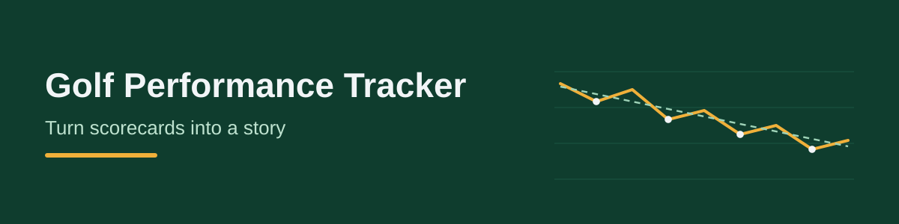
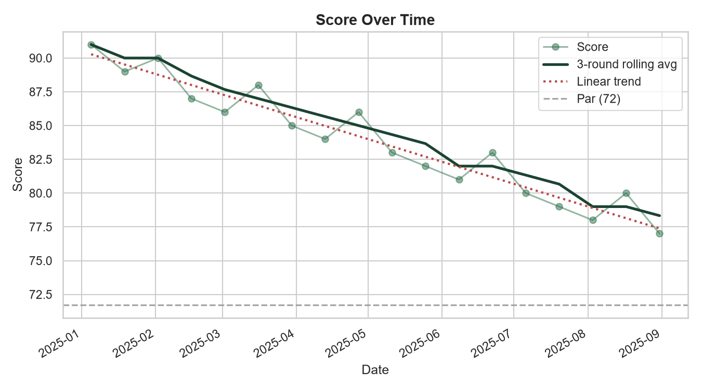
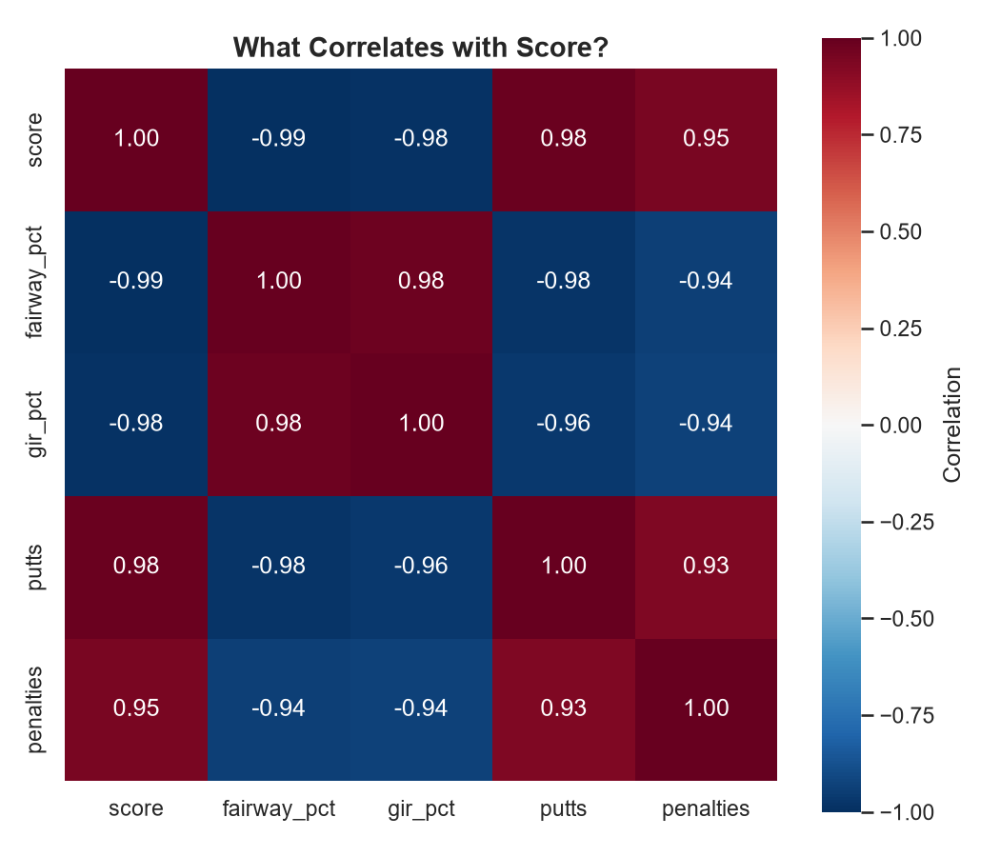
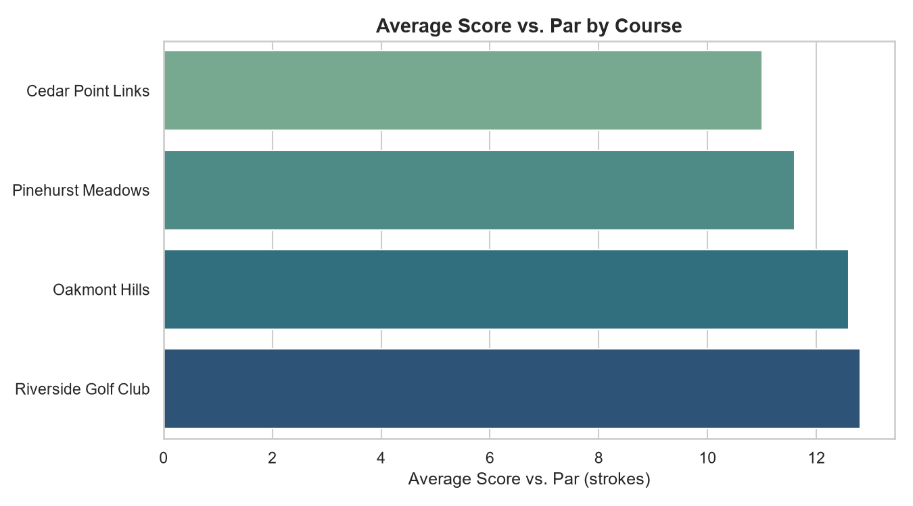
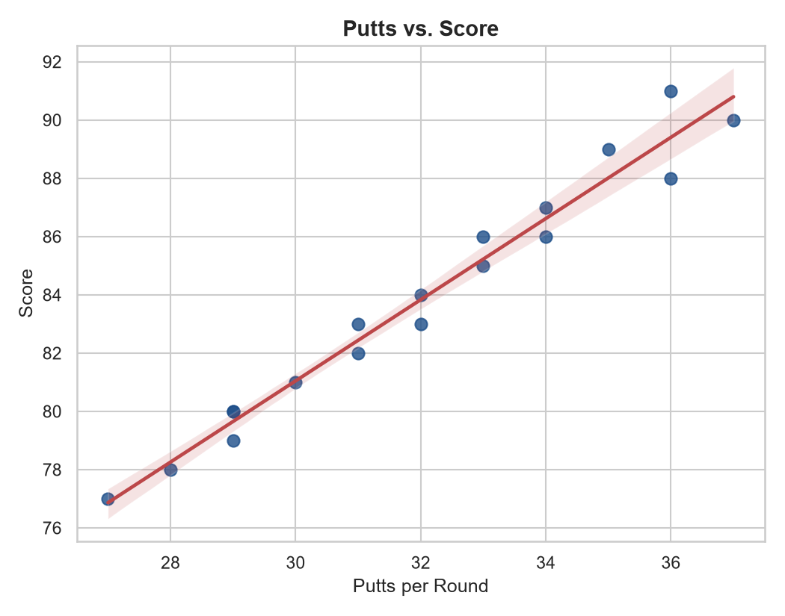

<a id="top"></a>

<p align="center">
  
</p>

# Golf Performance Tracker

**A Python analytics tool that turns my own golf rounds into trends, charts and an interactive dashboard.**

Log a round, analyse the numbers, and find out what is improving and what is costing strokes.

<p align="left">
  
  
  
  
</p>

**[Get started](#run-it) · [What it analyses](#what-it-analyses) · [Charts](#charts) · [Dashboard](#interactive-dashboard) · [Your own data](#your-own-data)**

## The idea

| The question | How the tool answers it |
| :--- | :--- |
| Am I actually getting better, or does it just feel that way? | A rolling average and a linear trend line show the direction of my scores. |
| Which part of my game costs me the most strokes? | Correlation analysis links score to fairways, greens in regulation and putts. |
| Do I play some courses better than others? | Score versus par is broken down by course. |
| Logging rounds by editing a CSV is a chore. | The dashboard has a form that adds a round in seconds. |

## Two ways to use it

| | `golf_analysis.py` | `dashboard.py` |
| :--- | :--- | :--- |
| **What it is** | Fast script | Interactive Streamlit app |
| **Best for** | A quick check after a round | Exploring and logging rounds |
| **Output** | Terminal summary and saved charts | Filters, KPI cards, Plotly charts and a round log |
| **Charts built with** | Matplotlib and Seaborn | Plotly |

## What it analyses

- **Score to par** for every round
- **Fairway %** to track driving accuracy
- **Greens in regulation (GIR)** to measure approach play
- **Putts per round** to show putting performance
- **3-round rolling average** to smooth out one-off bad rounds
- **Linear trend** to show scoring direction
- **Simplified handicap estimate** from the best recent rounds (not an official handicap)
- **Consistency** using the standard deviation of scores
- **Correlation analysis** to show which stats move with score

## Charts

The analysis script saves its charts to `golf-tracker/charts/`.

<table>
  <tr>
    <td width="50%" valign="top" align="center">
      
      <br /><sub><b>Score over time</b> with rolling average and trend line.</sub>
    </td>
    <td width="50%" valign="top" align="center">
      
      <br /><sub><b>Correlation heatmap</b> of score against fairways, greens and putts.</sub>
    </td>
  </tr>
  <tr>
    <td width="50%" valign="top" align="center">
      
      <br /><sub><b>Score versus par by course.</b></sub>
    </td>
    <td width="50%" valign="top" align="center">
      
      <br /><sub><b>Putts versus score</b> with a regression line.</sub>
    </td>
  </tr>
</table>

## Interactive dashboard

The Streamlit dashboard has everything the script does, plus:

- Date and course filters
- Live KPI cards
- Interactive Plotly charts you can hover and zoom
- A sortable round history
- Download of the filtered data as CSV
- A **Log a New Round** form, so there is no need to edit the CSV by hand

<table>
  <tr>
    <td width="50%" valign="top" align="center">
      
      <br /><sub><b>Overview</b></sub>
    </td>
    <td width="50%" valign="top" align="center">
      
      <br /><sub><b>Log a new round</b></sub>
    </td>
  </tr>
  <tr>
    <td width="50%" valign="top" align="center">
      
      <br /><sub><b>Correlation analysis</b></sub>
    </td>
    <td width="50%" valign="top" align="center">
      
      <br /><sub><b>Course statistics</b></sub>
    </td>
  </tr>
</table>

<a id="run-it"></a>

## Run it

```bash
git clone https://github.com/jarrudcochrane/golf-performance-tracker.git
cd golf-performance-tracker/golf-tracker
pip install -r requirements.txt
```

Run the analysis script. It prints a summary and saves the charts:

```bash
python golf_analysis.py
```

Run the dashboard:

```bash
streamlit run dashboard.py
```

## Your own data

Rounds are stored in `golf-tracker/data/rounds.csv`. Add a row by hand or use the **Log a New Round** form in the dashboard.

| Column | Description |
| :--- | :--- |
| `date` | Round date, `YYYY-MM-DD` |
| `course` | Course name |
| `par` | Course par, usually 71 or 72 |
| `score` | Total strokes |
| `fairways_hit` | Fairways hit |
| `fairways_total` | Fairways available |
| `greens_in_regulation` | Greens reached in regulation |
| `putts` | Total putts |
| `penalties` | Penalty strokes |

```csv
date,course,par,score,fairways_hit,fairways_total,greens_in_regulation,putts,penalties
2026-08-30,Example Golf Club,72,89,9,14,7,34,2
```

Every new round updates the rolling average, trend, handicap estimate, consistency and correlations.

## Tech stack

| Technology | Purpose |
| :--- | :--- |
| Python 3 | Core language |
| pandas | Loading, cleaning and aggregating rounds |
| NumPy | Calculations and the trend regression |
| Matplotlib and Seaborn | Static charts and the correlation heatmap |
| Streamlit | Interactive dashboard |
| Plotly | Interactive charts |

## Project structure

```text
golf-performance-tracker/
├── docs/assets/golf-banner.svg      Banner for this README
├── golf-tracker/
│   ├── data/rounds.csv              Round log
│   ├── charts/                      Saved charts and dashboard screenshots
│   ├── golf_analysis.py             Analysis script
│   ├── dashboard.py                 Streamlit dashboard
│   └── requirements.txt
└── README.md
```

## Ideas for next

- Club-by-club tracking (driver accuracy, approach distances)
- Weather data (temperature, wind, rain) and its effect on scoring
- A full handicap calculation instead of the simplified estimate
- Deploying the dashboard so it works from any device
- A phone-friendly layout for logging rounds on the course

Built by Jarrud Cochrane.

[Back to top](#top)
